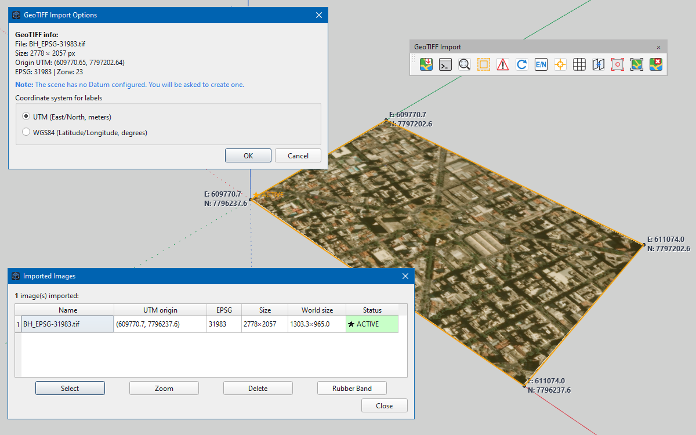

# igz_geotiff_import — Importação GeoTIFF e Kit de Ferramentas GIS para IngeTrazo

**Português (Brasil)** · [English](README.md)

Uma extensão de barra de ferramentas robusta e completa para o [IngeTrazo](https://github.com/ingelibre/ingetrazo), projetada para importar, gerenciar, anotar e georreferenciar **imagens GeoTIFF** (UTM e Web Mercator).

Diferente dos importadores de imagem padrão, este plugin insere ortofotos e imagens de satélite em suas posições espaciais corretas ancorando o `SceneDatum` da cena. Ele preserva a fidelidade geográfica enquanto mantém a câmera 3D estável perto da origem local `(0,0,0)`, prevenindo o notório *jitter* (tremor) de *float32* causado por coordenadas UTM brutas.

Este plugin fornece um conjunto completo de ferramentas de SIG dentro do IngeTrazo: rotulagem de coordenadas, reprojeção de zonas UTM (sem mover a geometria), grades de coordenadas, posicionamento interativo de pontos de coordenadas, recorte de imagem com gerenciamento de camadas, **captura de mapa base**, e um painel centralizado de gerenciamento.

- **Autor:** Ezequiel M. Rezende
- **Versão:** 1.4.0 (Adicionado **Capture Map** para captura do tile layer)
- **Testado com:** IngeTrazo 0.5.8 (Windows / Linux)
- **Licença:** GPL-3.0-or-later — a mesma do IngeTrazo

---



*A barra de ferramentas **GeoTIFF Import**. Na tela: uma ortofoto UTM ancorada no referencial local, a lista de **Imagens Importadas** detalhando a origem UTM e EPSG, o **rubber-band** (contorno) laranja delimitando a imagem ativa, e os rótulos de **Add Coordinates** em cada canto.*

---

## Instalação

### Instalação Manual
1. Baixe ou clone este repositório.
2. Localize a pasta de plugins do IngeTrazo:
   - **Linux:** `~/.local/share/ingetrazo/plugins/`
   - **Windows:** `%APPDATA%\ingetrazo\plugins\`
   - (Ou use **Extensions ▸ Open plugins folder** dentro do IngeTrazo).
3. Mova a pasta **`igz_geotiff_import`** descompactada para dentro dessa pasta de plugins.
4. Reinicie o IngeTrazo.

A barra de ferramentas **GeoTIFF Import** aparecerá na área superior, e um submenu em **Extensions ▸ GeoTIFF Import** também será criado.

### Dependências
**Nenhum pacote Python externo é necessário.** O importador utiliza nativamente o módulo interno `georef.geotiff` do IngeTrazo (para ler metadados e pixels) e o `core.texture.cache_image` (para armazenar a imagem em cache para o viewport 3D). A ferramenta **Capture Map** usa apenas `PySide6` (`QImage`, `QPainter`, `QBuffer`) e a API nativa `viewport.world_to_pixel`. Você não precisa instalar `GDAL`, `PIL`, `numpy`, `tifffile` ou qualquer outra biblioteca de terceiros. O plugin roda inteiramente no interpretador Python embutido do IngeTrazo.

---

## Guia de Uso das Ferramentas

Abaixo está o passo a passo detalhado de como interagir com cada uma das treze ferramentas disponíveis na barra.

### 1. Import GeoTIFF
* **O que faz:** Traz a imagem georreferenciada para dentro da cena e a insere na camada `IGZ_GeoTIFF_Images`.
* **Como usar:**
  1. Clique no botão **Import GeoTIFF**.
  2. Selecione um ou mais arquivos `.tif`/`.tiff` no disco.
  3. Uma janela aparecerá mostrando os metadados (EPSG, Zona UTM, tamanho). Escolha se os futuros rótulos (labels) usarão **UTM** (metros) ou **WGS84** (Latitude/Longitude).
  4. Se for a primeira imagem da cena, o IngeTrazo perguntará se deseja ancorar o Datum na localização da imagem. Clique em **Sim**.
  5. A imagem aparecerá próxima à origem `(0,0,0)` e pronta para uso.

### 2. Images List
* **O que faz:** Abre um painel de gerenciamento com todas as imagens importadas (originais, recortadas e capturas de mapa).
* **Como usar:**
  1. Clique em **Images List**.
  2. Você verá uma tabela com **Nome**, **Origem UTM**, **EPSG**, **Tamanho**, **Tamanho no mundo** e **Status** (★ ACTIVE).
  3. Selecione uma linha e use os botões inferiores:
     * **Selecionar:** Torna a imagem ativa (destacada em verde).
     * **Zoom:** Dá zoom e ativa a imagem.
     * **Excluir:** Apaga a imagem selecionada.
     * **Contorno (Rubber Band):** Liga/desliga o contorno laranja.

### 3. Zoom to Image
* **O que faz:** Move a câmera 3D para enquadrar perfeitamente a imagem ativa na tela.
* **Como usar:** Selecione uma imagem (via *Images List*) e clique no botão **Zoom to Image**. Se nenhuma imagem estiver ativa, o plugin abrirá a lista automaticamente para você escolher.

### 4. Toggle Rubber Band
* **O que faz:** Liga ou desliga uma linha laranja brilhante que contorna a imagem ativa.
* **Como usar:** Clique no botão. O contorno é atualizado em tempo real durante a rotação (Orbit) e o deslocamento (Pan) do modelo.

### 5. Check Zones
* **O que faz:** Verifica se há imagens na cena usando Zonas UTM diferentes.
* **Como usar:** Clique no botão. Se todas as imagens estiverem na mesma zona, aparecerá uma mensagem de confirmação. Se houver uma mistura (ex: Zona 23S e 22S), o plugin emitirá um alerta, pois mosaicos entre zonas diferentes não se alinham perfeitamente sem uma reprojeção prévia.

### 6. Reload Image
* **O que faz:** Recarrega a imagem do disco original (`.tif`).
* **Como usar:** Selecione a imagem (via *Images List*) e clique em **Reload Image**. Ele buscará o arquivo `.tif` original no caminho salvo (`original_path`), refará a textura e atualizará a cena sem mover a imagem. Isso é útil se você editou a ortofoto no QGIS.
* **Nota:** Se a imagem for um recorte (`Cropped`), o Reload recarregará o próprio PNG em cache do recorte, preservando o tamanho e a posição do momento do recorte. O `.tif` original em resolução plena **não** é recuperável a menos que tenha sido mantido em disco (ou seja, você respondeu **Não** ao "apagar imagem original?" durante o recorte).

### 7. Add Coordinates
* **O que faz:** Cria rótulos de texto nos quatro cantos da imagem ativa.
* **Como usar:**
  1. Selecione a imagem ativa.
  2. Clique em **Add Coordinates**.
  3. Confirme o diálogo. **Nota:** o campo "Espaçamento dos rótulos" (Label spacing) está reservado para uso futuro; os rótulos são sempre colocados nos quatro cantos da imagem.
  4. Os rótulos aparecerão na camada `IGZ_GeoTIFF_Labels`. O texto será em UTM (ex: `E: 609770.7 / N: 7797202.6`) ou WGS84, dependendo do que foi escolhido na importação.

### 8. Add Point Coordinate
* **O que faz:** Ativa uma ferramenta interativa para marcar coordenadas em pontos específicos da imagem.
* **Como usar:**
  1. Clique em **Add Point Coordinate**.
  2. O cursor se transformará em uma mira laranja.
  3. Clique em qualquer lugar da imagem. Um rótulo com a coordenada exata daquele pixel será criado.
  4. Continue clicando para adicionar quantos pontos quiser.
  5. Pressione **ESC** (ou mude para a ferramenta Select) para finalizar.

### 9. Coordinate Grid
* **O que faz:** Desenha uma grade de linhas sobre a imagem.
* **Como usar:**
  1. Selecione a imagem.
  2. Clique em **Coordinate Grid**.
  3. Digite o espaçamento em metros (ex: 100 m).
  4. A grade será desenhada e agrupada na camada `IGZ_GeoTIFF_Grid`.

### 10. Reproject Image
* **O que faz:** Muda a referência geográfica (ex: de UTM 23S para 22S) sem mover a imagem no espaço.
* **Como usar:**
  1. Com a imagem ativa, clique em **Reproject Image**.
  2. No diálogo, confirme a Zona de Origem, o Hemisfério de Origem, a Zona de Destino e o Hemisfério de Destino.
  3. Clique em OK. A imagem permanecerá exatamente no mesmo pixel da tela, mas todos os metadados e rótulos serão recalculados para a nova zona.

### 11. Crop Image
* **O que faz:** Recorta a imagem ativa usando um polígono ou retângulo desenhado sobre ela. O recorte é movido para a camada `IGZ_GeoTIFF_Cropped_Images`.
* **Como usar:**
  1. Selecione a imagem ativa (via *Images List*).
  2. Use a ferramenta de desenho nativa do IngeTrazo (Retângulo ou Polígono) para desenhar a área de corte sobre a imagem.
  3. Clique em **Crop Image**.
  4. O plugin extrairá a área e criará um novo plano de imagem alinhado perfeitamente.
  5. Uma janela perguntará: *"Deseja apagar a imagem original?"*. O padrão é **Sim**; escolha **Não** para manter as duas. Tudo (criação do recorte + exclusão opcional da original) ocorre em um único passo de `Ctrl+Z`.

### 12. Capture Map
* **O que faz:** Captura (screenshot) a área de um polígono/retângulo desenhado sobre o **mapa base (tile layer)** e a insere na cena como uma nova imagem georreferenciada, alinhada exatamente ao retângulo desenhado.
* **Como usar:**
  1. Desenhe um polígono ou retângulo com a ferramenta nativa do IngeTrazo sobre o mapa base. **Selecione-o**.
  2. Clique no botão **Capture Map**.
  3. No diálogo, clique em **Preparar Vista (Topo Paralelo)**. A câmera vai para uma vista **topo ortográfica** centralizada no polígono (`pitch = 90°`, `yaw = −90°`, com o norte para cima e sem rolar a planta); a distância é calculada para enquadrar os dois eixos do polígono com 10 % de margem. A captura só é habilitada depois deste passo.
  4. Clique em **Capturar Mapa**. A vista é renderizada pelo caminho de exportação do próprio viewport (`Viewport.render_image(..., overlays=False)`), mascarada exatamente pelo polígono (projetado com `viewport.world_to_pixel`), recortada pela *bounding box* e salva no cache. Se o polígono projetado for menor que **1 × 1 pixel**, a captura é abortada com um aviso.
  5. Uma nova `ImagePlane` travada (`locked=True`) é criada na camada `IGZ_GeoTIFF_Images`, passa a ser a **imagem ativa** e tem seus metadados gravados em `igz_image_metadata`. A inserção usa o `AddImagePlaneCommand` do host, portanto um único **Ctrl+Z** remove a captura e marca o documento como alterado exatamente uma vez.
* **Nota:** É necessário que exista um `scene.tile_layer` ativo e um polígono selecionado com pelo menos 3 vértices.

### 13. Delete Images
* **O que faz:** Remove todas as imagens georreferenciadas da cena.
* **Como usar:** Clique em **Delete Images**, confirme a exclusão e, se mudar de ideia, pressione **Ctrl+Z** para desfazer.

---

## Matemática e Lógica de Funcionamento (Deep Dive)

Abaixo está a explicação técnica de como cada arquivo Python (anexo ao plugin) opera nos bastidores.

### 1. `core.py` (i18n, Ícones, Metadados e Roteamento de Histórico)
* **Lógica:** Age como o centro de utilidades do plugin — uma única instância do módulo compartilhada por todas as ferramentas.
* **Matemática/Programação:**
  * **i18n:** Intercepta o idioma do host (`core.i18n.current_language()`) e carrega o JSON correspondente (`pt-BR.json`, `es.json`, …), com fallback para o `core.i18n.tr` do IngeTrazo e, por fim, para o texto-fonte em inglês.
  * **Ícones:** `load_icon` detecta o brilho da barra com `QPalette.Window.lightness() < 128` e escolhe `<nome>_light.svg` em tema escuro ou `<nome>.svg` em tema claro (com cache por nome/tema).
  * **Carregamento de módulos:** `load_module(name)` importa um arquivo relativo à pasta do plugin por caminho absoluto com `importlib.util`, registrando-o sob um nome privado — a mesma regra que o IngeTrazo aplica a plugins (o `sys.path` nunca é tocado).
  * **Metadados:** `image_metadata` / `set_image_metadata` leem e gravam `scene.igz_image_metadata[id(image)]`, já que `ImagePlane.__slots__` não deixa espaço para atributos extras.
  * **Histórico:** `history_for(app)` devolve `app.viewport.history` (com fallback para um `History` local à cena apenas se o host não tiver um) e `execute(app, command)` executa o comando nessa pilha e notifica o viewport — o único caminho de toda mutação do plugin.

### 2. `__init__.py` (Ponto de Entrada)
* **Lógica:** O orquestrador do plugin, seguindo o contrato `setup(app)` documentado para extensões em formato de pacote.
* **Programação:** Importa dinamicamente cada módulo de ferramenta por caminho absoluto (`importlib.util`) e cria **uma `QAction` por ferramenta**, compartilhada pela `QToolBar` e pelo submenu *Extensions ▸ GeoTIFF Import* — uma conexão, um rótulo traduzido e um tooltip. A barra é registrada em `app.window` (`Qt.TopToolBarArea`) e o menu por `app.add_menu(...)`. O overlay do rubber band é pré-instalado no viewport no `setup()`, ficando disponível independentemente de o botão ter sido clicado. `__version__` é reexportada de `core`.

### 3. `geotiff_importer.py` (Importação)
* **Lógica:** O coração geodésico do plugin.
* **Matemática:**
  * **Leitura:** Lê a matriz de transformação (`info.transform`), que contém o pixel scale (tamanho do pixel em metros) e o tiepoint (coordenada UTM do canto superior esquerdo).
  * **Conversão UTM -> WGS84:** Implementa as equações de Snyder para a projeção Transversa de Mercator. Calcula o arco de meridiano (`m`), a latitude de pé (`mu`), e usa séries de Taylor (`e1`, `phi1`) para encontrar a latitude e longitude reais.
  * **Ancoragem Local:** Pega a lat/lon e usa o `SceneDatum` para projetar no espaço 3D local. Isso evita que o modelo seja jogado a 600.000 metros da origem (o que causaria perda de precisão de float32 no OpenGL). Para **importações em lote**, o plugin calcula o centroide de lat/lon de todas as imagens e escolhe a imagem **mais próxima desse centroide** como âncora do Datum, garantindo que todo o lote caia próximo à origem.
  * **Camada e Textura:** Lê os pixels, aplica a proporção `height_px / width_px`, cria a textura e a insere na GPU via `core.texture.cache_image`. O `ImagePlane` é atribuído à camada `IGZ_GeoTIFF_Images` e o caminho do arquivo `.tif` original é salvo no metadado `original_path`.

### 4. `zoom_to_image.py` (Enquadramento)
* **Lógica:** Ajuste de câmera.
* **Matemática:** Calcula o centro geométrico da imagem `(xmin+xmax)/2`. A distância da câmera é definida como `max(largura, altura, profundidade) * 1.5 + 10.0` para garantir que a imagem caiba inteira na tela com uma margem de 50%.

### 5. `list_images.py` (Gerenciador)
* **Lógica:** Um `QDialog` com `QTableWidget`.
* **Programação:** Lê o dicionário `scene.igz_image_metadata` usando o `id(img)` como chave. Organiza os dados numa tabela (Nome, Origem UTM, EPSG, Tamanho, Tamanho no mundo, Status) e permite ao usuário disparar comandos (Zoom, Delete) diretamente. As deleções passam pelo `DeleteImagePlanesCommand` do host em `viewport.history`, garantindo o `Ctrl+Z`; o diálogo também limpa a imagem ativa quando exclui esse plano.

### 6. `rubber_band.py` (Overlay de Seleção)
* **Lógica:** Um widget sobreposto (`QWidget`) transparente aos cliques do mouse.
* **Matemática:** Ele intercepta o evento `paintEvent` do viewport. Para cada um dos 4 cantos da imagem (no espaço 3D), usa `viewport.world_to_pixel(corner)` para projetar na tela 2D. Então, desenha um polígono laranja via `QPainter.drawPolygon`. Como ele redesenha a cada frame, a linha acompanha perfeitamente a rotação da câmera.

### 7. `check_zones.py` (Verificador de Zonas)
* **Lógica:** Validação de integridade de mosaico.
* **Programação:** Varre todas as `image_planes` e lê o par `(utm_zone, utm_epsg)` de `scene.igz_image_metadata[id(img)]` (o próprio plano tem `__slots__` e não carrega atributos de CRS). Se houver mais de um par distinto, monta uma mensagem listando os conflitos; se houver apenas um, confirma que tudo está consistente; se nenhuma imagem tiver metadados de zona, avisa isso em vez de dizer que está tudo certo.

### 8. `reload_image.py` (Recarregamento)
* **Lógica:** Atualização sem exclusão, operando diretamente no arquivo original.
* **Programação:**
  * Busca o caminho original em `igz_image_metadata` (chave `original_path`). Se não existir, mostra um erro.
  * Lê o arquivo `.tif` com `georef.geotiff` e refaz o cache com `core.texture.cache_image`.
  * Atualiza o `img.path` para o novo cache por um comando do plugin (`_ReloadPathCommand`) na pilha de histórico do viewport, guardando o caminho anterior para que `Ctrl+Z` restaure a textura antiga.
  * Se a imagem for um recorte (cujo `original_path` aponta para o PNG do recorte), ele recarrega a si mesma sem deformar a imagem. **Contudo**, o `.tif` original em resolução plena não é recuperável a partir de um recorte, a menos que tenha sido mantido em disco.

### 9. `add_coordinates.py` (Labels nos Cantos)
* **Lógica:** Conversão matemática de coordenadas locais 3D para texto UTM/WGS84.
* **Matemática:**
  * Utiliza a função `datum.local_to_utm(pt)` para descobrir as coordenadas reais.
  * Se o sistema for WGS84, aplica a fórmula inversa de UTM para achar a latitude e longitude.
  * Cria objetos `TextLabel` ancorados no espaço 3D, mas com um offset de `Z + 1.0` para flutuar levemente acima da imagem, facilitando a leitura. São adicionados à camada `IGZ_GeoTIFF_Labels`.
  * **Nota:** o campo "Espaçamento dos rótulos" (Label spacing) no diálogo está reservado para uso futuro; os rótulos são sempre colocados nos quatro cantos da imagem.

### 10. `add_point_coord.py` (Ferramenta Interativa)
* **Lógica:** Uma subclasse de `Tool` nativa do IngeTrazo.
* **Programação:**
  * Substitui o cursor por um `QPixmap` desenhado programaticamente (uma mira laranja).
  * Intercepta `on_click(ctx)`. O `ctx.world` já fornece a coordenada 3D exata do clique (considerando a profundidade e a perspectiva da câmera).
  * Passa esse ponto 3D para a mesma função de conversão matemática do `add_coordinates.py`, gerando um rótulo individual.

### 11. `coord_grid.py` (Grade de Coordenadas)
* **Lógica:** Geração procedural de linhas.
* **Matemática:**
  * Pega a origem da imagem (`img.origin`) e seus vetores diretores `u` (eixo X) e `v` (eixo Y).
  * Normaliza esses vetores para encontrar o azimute da imagem no espaço (pois a imagem pode estar rotacionada).
  * Itera de `0` até o comprimento total (`ulen` e `vlen`) em passos iguais ao espaçamento (`step`).
  * Cria as linhas com `AddEdgeCommand`, adicionando-as à camada `IGZ_GeoTIFF_Grid`.

### 12. `reproject_image.py` (Mudança de CRS sem mover a imagem)
* **Lógica:** Preservação de posição espacial e atualização de metadados.
* **Matemática e Algoritmo (A Grande Inovação):**
  1. **Preservação da Origem:** O ponto `img.origin` (onde a imagem está no modelo 3D local) **não é alterado**.
  2. **Extração Geodésica:** O plugin descobre a Latitude e Longitude reais do ponto `img.origin` no Datum atual. Primeiro tenta `datum.local_to_geodetic(pt)`; se indisponível, faz fallback para `datum.local_to_utm(pt)` seguido de `_utm_to_wgs84(...)`.
  3. **Cálculo na Nova Zona:** Pega essa lat/lon e aplica as fórmulas de Transversa de Mercator de `_wgs84_to_utm` para a **nova zona de destino** (ex: Zona 22S). Isso gera um novo par `(Easting, Northing)`.
  4. **Atualização de Metadata:** O dicionário `igz_image_metadata` é atualizado com esse novo `utm_origin`, `utm_zone` e `epsg`. A imagem inteira "acredita" que agora está na nova zona, mas seu espaço geométrico não mudou.
  5. **Reescrita de Labels:** O código varre todos os `TextLabel` da camada `IGZ_GeoTIFF_Labels`. **Rótulos de lat/lon são detectados pelo prefixo textual** (`Lat`, `Lon`, case-insensitive) e deixados intocados, pois não dependem da zona UTM. **Rótulos UTM** são recalculados a partir da sua âncora 3D usando os novos metadados e reescritos como `label.text = f"E: {new_e:.1f}\nN: {new_n:.1f}"`.
  6. **Undo Seguro:** Metadados e textos são agrupados em um `CompoundCommand` — `EditTextLabelCommand` para cada rótulo reescrito e um pequeno comando para a troca do registro em `igz_image_metadata`. Um único `Ctrl+Z` restaura os metadados antigos e os textos antigos de uma só vez.


### 13. `crop_image.py` (Recorte com preservação espacial e camadas)
* **Lógica:** Recortar a textura mantendo as coordenadas locais e geográficas perfeitamente alinhadas, promovendo organização por camadas.
* **Matemática e Algoritmo:**
  1. **Conversão 3D para UV:** Lê os vértices do polígono desenhado e projeta-os ortogonalmente no plano da imagem original usando Produto Escalar (`u_coord = (dp · u) / |u|²`). O resultado é uma bounding box de 0.0 a 1.0.
  2. **Máscara e Recorte:** Em vez de usar `Pillow`, o plugin usa `QImage` e `QPainter` nativos. Ele desenha o polígono em uma máscara de canal alfa e usa `CompositionMode_DestinationIn` para apagar tudo fora do polígono. Em seguida, corta a bounding box.
  3. **Ancoragem:** O novo `ImagePlane` é ancorado no **canto inferior-esquerdo** do polígono. Os novos vetores `u` e `v` são calculados multiplicando os vetores originais pela diferença proporcional (ex: `max_u - min_u`). Isso garante que a imagem recortada ocupe exatamente o retângulo desenhado no espaço 3D, sem "flutuar" ou desalinhar.
  4. **Camada e Metadados:** O novo plano é inserido na camada `IGZ_GeoTIFF_Cropped_Images`. Seu `original_path` é definido como o seu próprio caminho de cache (para que um `Reload` futuro não carregue o arquivo `.tif` grande e esprema a imagem). O usuário é questionado se deseja apagar a imagem original (**padrão: Sim**). A criação do novo plano e a deleção do antigo vão para um único `CompoundCommand` com os comandos `AddImagePlaneCommand` / `DeleteImagePlanesCommand` do host, então todo o recorte é um passo de `Ctrl+Z`.

### 14. `capture_map.py` (Captura de Mapa)
* **Lógica:** Converte a área desenhada sobre o **mapa base (tile layer)** em uma nova `ImagePlane` georreferenciada, alinhada ao polígono selecionado.
* **Programação e Matemática:**
  * **Validação:** Exige `scene.tile_layer` ativo e um polígono selecionado (mín. 3 vértices). Os vértices são extraídos das *faces* e *edges* da `loose_mesh` selecionada, ordenados por ângulo em torno do centroide para garantir o fechamento correto.
  * **Preparar Vista:** Move a câmera para uma vista **topo ortográfica** centralizada no centro do polígono. Calcula `center = ((min_x+max_x)/2, (min_y+max_y)/2)`, `pitch = 90°` e `yaw = −90°` (em **radianos**, conforme IngeTrazo), e uma distância que enquadra o polígono nos dois eixos: `distance = max(altura/2, (largura/2)/aspect) / tan(fov/2) × 1.1`. Só então habilita o botão de captura.
  * **Render Off-screen:** Usa `Viewport.render_image(width, height, overlays=False)` — o caminho de exportação do próprio host, que renderiza a cena OpenGL em um FBO sem o marcador de snap, o hover nem o rubber band laranja do plugin. Se o host não tiver essa API, cai para `viewport.render(...)` pedindo só o fundo (nunca `DrawChildren`, para o overlay não vazar para a imagem).
  * **Projeção 3D → 2D:** Para cada vértice do polígono, usa `viewport.world_to_pixel(p)` para obter as coordenadas exatas na tela, escalando dos pixels lógicos do widget para o tamanho da imagem renderizada quando diferirem. Se a API falhar, aborta com erro.
  * **Máscara e Composição:** Desenha o polígono projetado em uma máscara (`QPainter.Antialiasing`) e aplica com `CompositionMode_DestinationIn`, apagando tudo fora do polígono.
  * **Bounding Box:** Recorta a `final_img` a partir do `min/max` dos pontos de tela (com clamp em `[0, width/height]`). Se o recorte for **< 1 px**, avisa e aborta.
  * **Cache:** Serializa o PNG em `QBuffer` e salva via `core.texture.cache_image(img_bytes, name, "imported")`, com nome carimbado (`Map_Capture_AAAAMMDD_HHMMSS`).
  * **Inserção no Mundo:** Cria uma nova `ImagePlane` com `origin = (min_x, min_y, 0)` (canto inferior-esquerdo do polígono em 3D), `u = (width_3d, 0, 0)` e `v = (0, height_3d, 0)`. A proporção `aspect = height_px / width_px` é preservada. A imagem é **`locked=True`** (não desloca com o plano do chão) e inserida na camada `IGZ_GeoTIFF_Images`.
  * **Metadados:** Lê o `SceneDatum` da cena — que ancora lat/lon na origem local `(0,0,0)` — e grava a **UTM real** do canto inferior-esquerdo (`utm_origin`, via `datum.local_to_utm`), `utm_zone`, `utm_northern`, `utm_epsg` (32600/32700 + zona), `wgs84_origin` (via `datum.local_to_geodetic`), `pixel_scale` (metros por pixel da captura), `image_size`, `near_origin` e `original_path` (o PNG do cache) em `igz_image_metadata[id(new_img)]`. Sem datum, grava metros locais e `coord_system="local"` em vez de inventar um CRS.
  * **Undo:** Um único `AddImagePlaneCommand` em `viewport.history` — a mesma pilha que o `Ctrl+Z` aciona. O comando cria a camada e a remove de novo no undo, mantendo documento, flag *dirty* e o `*` do título consistentes.

### 15. `delete_images.py` (Exclusão)
* **Lógica:** Remoção limpa de todas as imagens importadas, com histórico.
* **Programação:** Agrupa todas as `image_planes` em um único `DeleteImagePlanesCommand` executado em `viewport.history` (nunca numa pilha privada), então o comando oficial do IngeTrazo mantém a árvore de Undo/Redo — e a flag *dirty* do documento — impecáveis. Excluir a imagem ativa limpa a referência de imagem ativa do plugin.

---

## Arquitetura e Estrutura de Arquivos

```text
<plugins>/
└── igz_geotiff_import/
    ├── __init__.py              # setup(app): barra + menu Extensions
    ├── core.py                  # i18n (tr), ícones, metadados, roteamento de histórico
    ├── README.md
    ├── README_ptBR.md
    ├── screenshots/             # Imagens usadas pelos dois READMEs
    │   └── igz_geotiff_import.png
    ├── icons/                   # Ícones SVG (temas claro/escuro)
    │   ├── geotiff_import.svg / _light.svg
    │   ├── geotiff_capture.svg / _light.svg
    │   ├── geotiff_list.svg / _light.svg
    │   ├── geotiff_zoom.svg / _light.svg
    │   ├── geotiff_rubber.svg / _light.svg
    │   ├── geotiff_warning.svg / _light.svg
    │   ├── geotiff_reload.svg / _light.svg
    │   ├── geotiff_coords.svg / _light.svg
    │   ├── geotiff_point.svg / _light.svg
    │   ├── geotiff_grid.svg / _light.svg
    │   ├── geotiff_reproject.svg / _light.svg
    │   ├── geotiff_crop.svg / _light.svg
    │   └── geotiff_delete.svg / _light.svg
    ├── i18n/                    # Catálogos de tradução JSON (mesmo conjunto de chaves)
    │   └── en.json, pt-BR.json, de.json, es.json, fr.json, it.json, zh-CN.json
    └── tools/
        ├── __init__.py          # Marcador de pacote (ferramentas carregam por caminho absoluto)
        ├── geotiff_importer.py  # Lógica central de leitura e posicionamento
        ├── capture_map.py       # Captura do tile layer para uma nova ImagePlane
        ├── zoom_to_image.py     # Enquadramento da câmera
        ├── list_images.py       # Diálogo de gerenciamento de imagens
        ├── rubber_band.py       # Overlay do viewport
        ├── check_zones.py       # Aviso de incompatibilidade de CRS
        ├── reload_image.py      # Recarregador de arquivo
        ├── add_coordinates.py   # Rotulagem de cantos
        ├── add_point_coord.py   # Ferramenta interativa de rotulagem
        ├── coord_grid.py        # Geração de arestas da grade
        ├── reproject_image.py   # Lógica de reprojeção de zona/CRS
        ├── crop_image.py        # Recorte de polígono com camadas e preservação de CRS
        └── delete_images.py     # Exclusão em lote com desfazer
```

Na raiz do repositório (fora do pacote instalável): `LICENSE`, `THIRD-PARTY.md`,
`.gitignore` e a pasta de trabalho `Desenvolvimento/` (apenas local, nunca
versionada).

---

## Detalhes de Georreferenciamento e Metadados

Quando uma imagem é importada (ou capturada do tile layer), ela armazena seu georreferenciamento original em `scene.igz_image_metadata[id(image)]`.

| Chave | Significado |
| :--- | :--- |
| `utm_origin` | `(x, y)` no CRS nativo da imagem |
| `utm_epsg` | Código EPSG (ex: 31983 para UTM 23S, 3857 para Web Mercator) |
| `utm_zone` | Zona UTM (1–60), ou `None` para Web Mercator |
| `utm_northern` | `True` para o hemisfério norte, `False` para o sul |
| `pixel_scale` | `(scale_x, scale_y)` da transformação do GeoTIFF |
| `image_size` | `(width_px, height_px)` |
| `near_origin` | Sempre `True` (o plugin sempre usa o Datum) |
| `coord_system` | `"utm"` ou `"wgs84"` (escolhido durante a importação) |
| `wgs84_origin` | `(lat, lon)` do canto inferior esquerdo |
| `original_path` | Caminho absoluto para o arquivo `.tif` de origem (ou o cache do recorte/captura) |

> **Nota sobre `Capture Map`:** os metadados da captura vêm do `SceneDatum` da cena (`datum.local_to_utm` / `datum.local_to_geodetic`), portanto `utm_origin` e `wgs84_origin` são **coordenadas reais** do canto inferior-esquerdo do polígono na zona do datum — nada é hardcoded. `pixel_scale` é o metro-por-pixel da captura e `original_path` aponta para o PNG em cache (não um `.tif`), então o `Reload` relê esse PNG. Quando a cena não tem datum, o registro guarda metros locais e define `coord_system="local"`.

---

## A Arquitetura de Undo/Redo

Toda mutação neste plugin (Importação, **Capture Map**, Exclusão, Reprojeção, Rótulos, Grade, Recorte) é roteada pela camada de comandos do IngeTrazo e executada em **`viewport.history`** — a mesma pilha que o `Ctrl+Z` aciona. Nenhuma ferramenta cria um `History` privado: uma pilha solta alteraria o documento deixando a pilha do viewport, a flag *dirty* e o `*` do título intocados. `core.execute(app, command)` é o único ponto que roteia um comando e chama `viewport.notify_scene_changed()`.

Importações de múltiplos arquivos, recortes (incluindo a exclusão opcional da imagem original), lotes de rótulos, grades, reprojeções e **capturas de mapa** são compostos com os comandos do próprio host (`AddImagePlaneCommand`, `DeleteImagePlanesCommand`, `AddTextLabelCommand`, `AddEdgeCommand`, `AssignLayerCommand`, `EditTextLabelCommand`), agrupados por `CompoundCommand` quando há mais de um. Cada ferramenta chega à pilha do viewport como **um** passo: um único `Ctrl+Z` reverte a operação inteira, e a flag *dirty* do documento acompanha.

---

## Limitações Conhecidas

Os comportamentos abaixo são **intencionais ou limitações atuais** da versão 1.4.0. Eles estão documentados aqui para que os usuários não se surpreendam com os resultados:

- **`Capture Map` — precisa de datum para metadados UTM:** com um `SceneDatum` o registro carrega as coordenadas UTM/WGS84 reais; sem ele, guarda metros locais e `coord_system="local"` (a imagem continua caindo corretamente na cena).
- **`Capture Map` — a resolução segue a vista:** a captura é renderizada no tamanho em pixels do viewport; aproxime o zoom antes de capturar quando precisar de mais detalhe.
- **`Capture Map` — `Preparar Vista` altera a câmera:** força projeção ortográfica, `pitch = 90°`, `yaw = −90°` (norte para cima, sem rolagem) e centraliza a câmera no polígono. Qualquer rotação manual é substituída — é isso que faz as tiles serem capturadas sem cisalhamento.
- **`Capture Map` — tamanho mínimo:** Se o polígono projetado for menor que 1 × 1 pixel na tela, a captura é abortada com um aviso.
- **`Add Coordinates` — "Espaçamento dos rótulos" está reservado:** O campo existe no diálogo mas ainda não é usado. Os rótulos são sempre colocados nos quatro cantos da imagem ativa.
- **`Reproject Image` — detecção de rótulos lat/lon é textual:** Um rótulo é considerado "lat/lon" (e deixado intocado) apenas se seu texto começar com `Lat` ou `Lon` (case-insensitive). Rótulos com outros prefixos (ex: `L:`, `Y:`, ou equivalentes localizados) serão reescritos incorretamente como UTM. Se você precisar de formatos personalizados, edite os rótulos manualmente após a reprojeção.
- **`Reload Image` — recortes não têm resolução plena:** Após o recorte, o `original_path` aponta para o PNG em cache do recorte. O `Reload` relê esse PNG, não o `.tif` original. Para recuperar a resolução plena, mantenha o `.tif` original em disco (ou seja, responda **Não** ao "apagar imagem original?" durante o recorte) e reimporte-o.
- **i18n — nome do catálogo chinês:** O catálogo é distribuído como `zh-CN.json` (ISO 639-1). Se a sua build do IngeTrazo reportar um código de idioma diferente via `core.i18n.current_language()` (ex: `zh-Hans`, `zh-CH`, `zh_TW`), renomeie o arquivo de acordo ou o plugin cairá no fallback inglês para usuários chineses.

---

## Compatibilidade com a API de Plugins do IngeTrazo

De acordo com o [`docs/plugins.md`](https://github.com/ingelibre/ingetrazo/blob/main/docs/plugins.md), a API de plugins ainda não é estável na série 0.x. Este plugin segue as diretrizes oficiais para extensões em formato de pacote:

- uma função `setup(app)` no nível do módulo, recebendo um `views.extension_api.ExtensionApp` (`app.window`, `app.viewport`, `app.scene`, `app.add_menu`);
- carregamento por caminho absoluto com `importlib.util` (a pasta do plugin nunca entra no `sys.path`);
- tolerância a falhas: nada levanta exceção durante a inicialização do IngeTrazo e as ferramentas reportam erros em diálogos.

Ele também se apoia em alguns símbolos internos estáveis do IngeTrazo (testado com 0.5.8):

- `georef.geotiff` e `georef.datum.SceneDatum` (metadados, pixels, local ↔ geodésico)
- `core.texture.cache_image` (armazenamento em cache da textura)
- `core.image_plane.ImagePlane` (classe base do plano 3D)
- `core.history` (comandos de desfazer/refazer: `AddImagePlaneCommand`, `DeleteImagePlanesCommand`, `AddEdgeCommand`, `AssignLayerCommand`, `AddTextLabelCommand`, `EditTextLabelCommand`, `CompoundCommand`)
- `core.layers` e `core.textlabel` (gerenciamento de camadas e textos)
- `views.viewport.Viewport` (`history`, `notify_scene_changed`, `world_to_pixel`, `render_image`)

---

## Licença

GPL-3.0-or-later — a mesma licença do IngeTrazo.

Copyright (C) 2026 Ezequiel M. Rezende.

Este programa é um software livre: você pode redistribuí-lo e/ou modificá-lo sob os termos da Licença Pública Geral GNU, versão 3 ou posterior, conforme publicada pela Free Software Foundation.

Este programa é distribuído na esperança de que seja útil, mas **sem qualquer garantia**; sem sequer a garantia implícita de **comercialização** ou **adequação a um propósito específico**. Veja a Licença Pública Geral GNU para mais detalhes.

Veja <https://www.gnu.org/licenses/gpl-3.0.html>.

